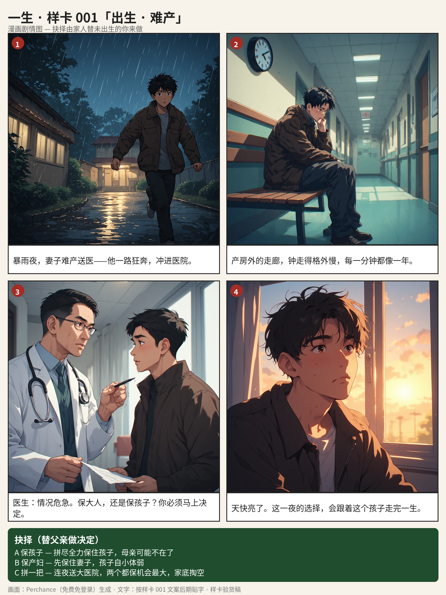

# 异生 · Another Life

> 出生与死亡之间，都是你的选择。

一款人生模拟游戏：你将随机（或亲手定制）出生在全球某个家庭，以漫画剧情图推进情景抉择，从出生活到死亡——一局 15～25 分钟，活完一整个人生。每一局，都是另一个人的人生。



## 玩法

- **三层人生生成器**：出生地（12 个文化地理区）× 家庭出身（富裕／小康／普通／贫寒）× 本人志向（科研／旅行／艺术／创业／从医／安稳……），可全随机、锁定重抽、逐层定制。
- **文化包**：出生地同时锁定这一生的**长相包**（人物相貌、服饰、建筑）与**语言包**（文本语言、人名地名、称谓习惯）——选了欧洲人，就不会长着亚洲脸说中文名。
- **主线**：出生 → 死亡两端钉死，中间没有固定剧本。故事由玩家选择、随机际遇与活世界（配角各自的人生轨迹）共同生成；早年的选择会在多年后回响。
- **落幕**：死亡由年龄与健康共同判定，结局有称号、总评与完整的一生日志回顾。

## 当前进度（v0.1 简易版）

- ✅ 可玩闭环：生成器 → 出生漫画开场 → 六段人生事件 → 死亡判定 → 人生总结
- ✅ 6 个出生地、28 个分段事件＋4 个随机际遇＋志向专属事件、结局称号 8 种
- ✅ 人生状态系统：选择会留下状态（辍学／工作／成婚／育儿／离乡），后续事件按状态筛选，不再前后矛盾
- ✅ 情景插图联网生成（v0.2.0）：选完人生开局后，每个事件出现时按出生地文化包＋年龄＋性别实时生成动漫风插图（免费服务 Pollinations），只生成这一局遇到的，不预置图库；断网自动回退文字场景
- ✅ 出生场景漫画图（亚洲包 4 格／西欧包 2 格，Perchance 免费生成＋后期贴字）
- 🚧 目标：事件扩至约 220 个、12 区文化包补全、Windows 正式安装包、时长定制档位

设计文档在 [`docs/`](docs/)：对齐方案、主线故事梳理、样卡图。

## 怎么玩 / 怎么运行

- **玩家**：去 [Releases](../../releases) 下载 Windows 版 zip，解压后双击 `AnotherLife.exe`——独立窗口的程序版，免安装、不联网（打包方法见 [`packaging/打包说明.md`](packaging/打包说明.md)）。
- **开发者**：直接用浏览器打开 `src/index.html` 即可调试游玩（无需服务器、无需联网）。

打包单文件本体：

```bash
python3 tools/build-standalone.py   # 生成 dist/yisheng.html（图片内嵌，供打包与调试）
```

## 参与进来

欢迎一切形式的参与——写事件剧情（不会编程也能投）、出漫画图、改代码、提建议：

- 先读 [`CONTRIBUTING.md`](CONTRIBUTING.md)（参与说明＋事件模板）
- 想法与 bug 请开 [Issues](../../issues)
- 代码改动请 Fork 后发 Pull Request，仓主审核合并

## 许可证

GPL-3.0（见 [`LICENSE`](LICENSE)）：可以自由使用、修改、分发，但分发的衍生作品必须同样以 GPL 开源——禁止闭源商用。
